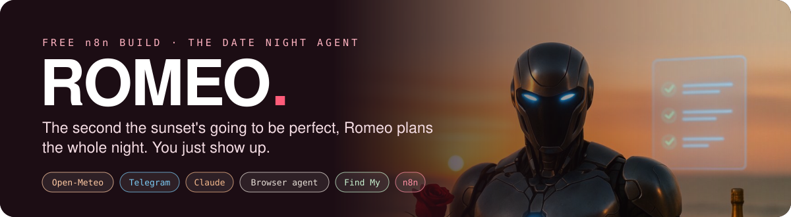
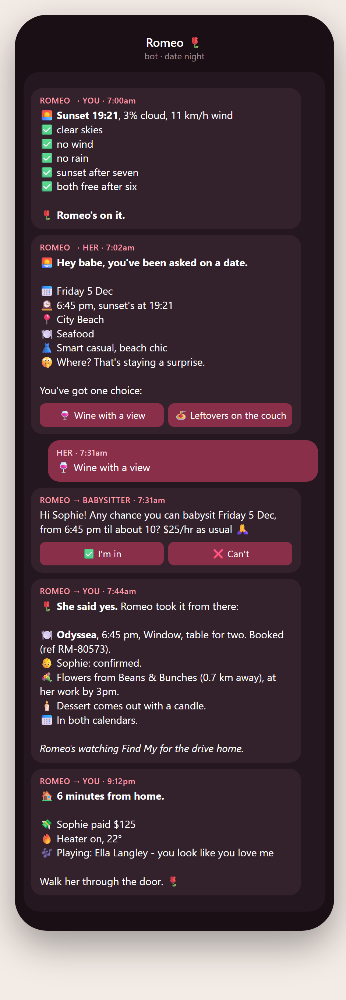
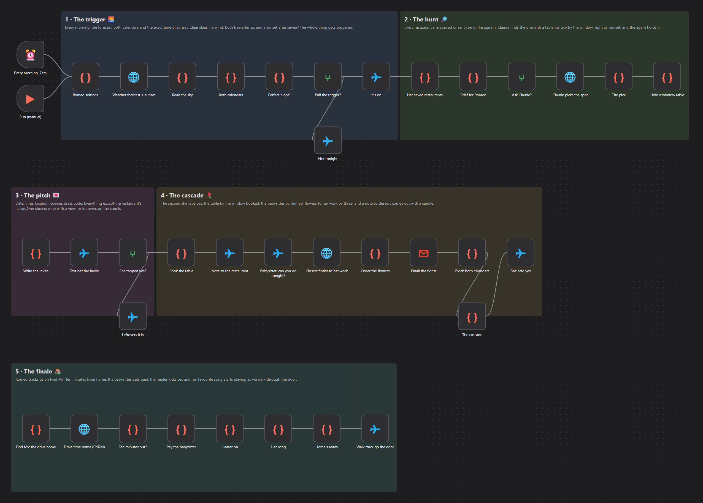

  

  <b>Every morning Romeo checks the forecast, both your calendars and the exact time of sunset. 
  When it's going to be perfect, he picks a restaurant she's saved, invites her (without saying where), 
  and the second she taps yes he books the table, the babysitter and the flowers. 
  Ten minutes from home, the babysitter gets paid, the heater kicks on and her song starts playing.</b>

  
  &nbsp;
  

  
  
  
  
  
  

---

## 👋 Never used GitHub? You're in the right place.

This page is just where the file lives. **You don't need to code, and you don't need a GitHub account.**

| | Step | What to do |
|:-:|---|---|
| **1** | **Get n8n** | n8n is the free app that runs automations like this one. The easiest way in is the free trial of [n8n Cloud](https://n8n.io/): sign up, and you're looking at an empty canvas. |
| **2** | **Download Romeo** | Hit the pink **Download the demo** button above. You get a small file ending in `.json`. That file *is* the automation. |
| **3** | **Drop him in** | In n8n, open a new workflow, click the **⋯** menu (top right) → **Import from File**, and pick the file. Romeo appears on your screen, ready to go. |

Then follow **[Try the demo](#-try-the-demo-about-10-minutes)** below. One click runs the whole night, start to finish, and every message comes to **your own phone**.

---

## 📱 What it actually sends

  

---

## 🌅 The night, step by step

| | Romeo… | In plain English |
|:-:|---|---|
| 🌤️ | **watches the sky** | Every morning: the forecast and the exact time of sunset. He only fires on **clear skies, no wind, no rain and a sunset after seven**. |
| 📅 | **checks you're both free** | Your Google calendar and hers, **after six**. |
| 📌 | **remembers her saves** | Forward him any restaurant post from Instagram and he files it. |
| 🔎 | **does the hunt** | Claude looks at every place she's saved and picks the one with **a table for two by the window, right on sunset**. A browser agent checks there's actually a table. Nothing's booked yet. |
| 💌 | **invites her** | Date, time, location, cuisine, dress code. **Everything except the restaurant's name.** She gets one choice: 🍷 *wine with a view*, or 🍝 *leftovers on the couch*. |
| 🌹 | **books it all, only on yes** | The window table (with a note so **dessert comes out with a candle**), the babysitter, **flowers to her work by 3pm** from the closest florist, and the night in both calendars. |
| 🏠 | **gets home ready** | Tracks your phone on the drive home. **Ten minutes out:** the babysitter gets paid, the heater kicks on, and her favourite song starts playing as you walk through the door. |

```mermaid
flowchart LR
    A["🌤️ Perfect sunset<br/><i>+ both free</i>"] --> B["🔎 Her saved spots<br/><i>Claude picks one</i>"]
    B --> C["🪑 Table free?<br/><i>browser agent</i>"]
    C --> D{"💌 Wine with a view,<br/>or leftovers?"}
    D -->|🍷| E["🍽️ Table booked<br/><i>+ candle note</i>"]
    E --> F["👶 Babysitter"]
    F --> G["💐 Flowers<br/><i>to her work by 3</i>"]
    G --> H["📅 Both calendars"]
    H --> I["📍 Drive home"]
    I --> J["🏠 10 min out:<br/>paid · heater · her song"]
    D -->|🍝| K["😴 Couch"]

    style A fill:#FF9F5A,stroke:#c46f30,color:#2b1300
    style B fill:#D97757,stroke:#a8553a,color:#fff
    style C fill:#6b4a5a,stroke:#4a3240,color:#fff
    style D fill:#FF5A7A,stroke:#c43a57,color:#fff
    style E fill:#3B1424,stroke:#24090f,color:#fff
    style F fill:#3B1424,stroke:#24090f,color:#fff
    style G fill:#3B1424,stroke:#24090f,color:#fff
    style H fill:#4285F4,stroke:#2a62c0,color:#fff
    style I fill:#2a3a3a,stroke:#1a2626,color:#fff
    style J fill:#FFC56B,stroke:#c79540,color:#3b2a00
    style K fill:#f2f0eb,stroke:#c9c3b8,color:#25292e
```

---

## 🖥️ What it looks like inside n8n

  

---

## 🧠 How Romeo does the "impossible" bits

Most automation demos quietly aren't. Here's the honest version.

- **Her Instagram saves.** Instagram has **no way for an app to read your saved posts**. So Romeo has a Telegram bot: she (or you) **forwards any restaurant post to it**, Claude reads the post, and if it's a restaurant he files it. Your list builds up as you scroll.
- **Booking the table.** Australian restaurants don't have a public booking API. Romeo uses a **browser agent**: an AI that drives a real web browser and uses the restaurant's own booking page the way you would. In the morning it only **checks** there's a table. It books **only after she taps yes**, and it stops and messages you if a page wants a deposit.
- **"Tracks us on Find My."** Apple has no Find My API for apps, and never has. The workaround is a **two-step iPhone Shortcut** (or the free OwnTracks app) that sends your phone's location to Romeo every few minutes after dinner. Same result, and it's your own phone.
- **Paying the babysitter.** Australian banks don't let apps send money. **Wise** does: Romeo works out the hours and sends her pay from your Wise balance. Not on Wise? Swap that node for a Telegram message with the amount and her PayID.
- **The heater.** [Home Assistant](https://www.home-assistant.io/) talks to almost every smart heater, air con and plug. Romeo asks it to turn the heater on.
- **Her song.** Spotify starts it on whatever speaker you last played on (needs Spotify Premium).

---

## 🎬 Try the demo (about 10 minutes)

The demo runs the whole night in **one click** and sends everything to **you**: you play her, the babysitter and the restaurant. It costs about **1 cent** (one Claude call).

**What's real in the demo:** the live forecast and sunset time, Claude picking from a sample list of saved restaurants, the invite with its two buttons, the babysitter's yes/no, the **closest real florist** to her work (OpenStreetMap), the order email (to your inbox) and real **drive times** home. **Simulated:** the two calendars, the browser agent, the drive itself, Wise, the heater and Spotify. Each simulated node says so in its first line and returns exactly what the real one does.

1. **Make a Telegram bot** (2 min). In Telegram, message **@BotFather** → send `/newbot` → follow the prompts. It gives you a **token**. Then message your new bot once, and open `https://api.telegram.org/bot<YOUR TOKEN>/getUpdates` in a browser: the number after `"chat":{"id":` is your **chat id**.
2. **Import the demo** (step 3 at the top).
3. **Connect your accounts.** Any node with a red warning needs one. Click it → **Credential** → **Create new**:
   - **Telegram**: your bot token
   - **Anthropic** (Claude): an API key from [console.anthropic.com](https://console.anthropic.com/). Set `ZERO_SPEND: true` in the settings to skip it.
   - **Gmail**: sign in with Google
4. **Open ⚙️ Romeo settings** (the first node) and put in your chat id, your email, and roughly where home and her work are.
5. Click **Execute workflow**, tap **🍷 Wine with a view**, then **✅ I'm in**, and watch your phone.

> 🌧️ **Not a perfect night when you try it?** The demo knows. `FORCE_GO: true` makes it carry on anyway so you see the whole thing. The full build only ever fires on the real thing.

---

<b>🛠️ Running the full build for real (click to open)</b>

 

The full build has three triggers on one canvas: **7am every morning** (the sky, the hunt, the invite, the bookings), **her saves** (a Telegram message) and **the drive home** (a webhook your iPhone posts to).

**Accounts you'll need:**

| Service | What it does | n8n credential |
|---|---|---|
| Telegram bot | the invite, the babysitter, her saves | Telegram API |
| Claude | picks the spot, reads her saves | Anthropic API |
| Google Calendar | free/busy for both of you, and the booking | Google Calendar OAuth2 |
| Gmail | the florist order | Gmail OAuth2 |
| Google Places | details for each saved spot | Header Auth: `X-Goog-Api-Key: <key>` |
| Browser Use | checks and books the table | Header Auth: `X-Browser-Use-API-Key: <key>` |
| Wise | pays the babysitter | Header Auth: `Authorization: Bearer <token>` |
| Home Assistant | the heater | Header Auth: `Authorization: Bearer <long-lived token>` |
| Spotify | her song | Spotify OAuth2 (Premium) |

**One data table** (n8n → **Data tables**, every column text): `romeo_saves`: `name`, `suburb`, `cuisine`, `ig`, `saved_at`

**Her and your babysitter** each send your bot one message (anything), so Romeo can message them back. Their chat ids go in **⚙️ Romeo settings**.

**The drive home:** make an iPhone Shortcut automation that runs every few minutes in the evening: **Get Current Location** → **Get Contents of URL** (POST, JSON body `lat` and `lon`) to your **Find My (iPhone Shortcut)** webhook URL. Romeo ignores it on any night without a booking, and fires the finale once.

**Then:** fill in **⚙️ Romeo settings** and its two copies (**Romeo settings (home)**, **Romeo settings (saves)**: the lanes run separately, so each has its own), and **activate**.

**Honest limits:**
- Claude can't *see* the window. It judges from her saves, Google's description and reviews. Water, west-facing and "sunset" in the reviews win.
- The browser agent is quick, not magic. If a booking page changes, wants a deposit or throws a CAPTCHA, it stops and tells you. She's already said yes by then, so you'll want to book it yourself.
- Whether "sunset after seven" ever happens depends on where you live and the time of year. Change `sunsetAfter` in the settings.
- Wise transfers need a Wise account with money in the balance. Spotify needs Premium.

---

## ❓ Questions people ask

<b>Do I need to know how to code?</b>
 No. You import a file and fill in a settings box. The code is already written.

<b>What does it cost?</b>
 The workflow is free. n8n Cloud has a free trial, or you can run n8n yourself for free. The demo costs about 1 cent. The full build costs a few cents a morning (Claude + Google Places), plus the browser agent on nights it actually books (capped in the settings).

<b>Will she find out?</b>
 She'll find out the restaurant when you get there. Romeo never tells her the name.

<b>We don't have kids.</b>
 Delete the two babysitter nodes. Everything else still works.

<b>I'm stuck.</b>
 Screenshot the node with the red warning and send it to <a href="https://www.instagram.com/aaronautomates/">@aaronautomates</a> on Instagram.

---

Free under the MIT licence. Built by <a href="https://myceliumai.com.au">Mycelium AI</a> in Perth · more builds at <a href="https://aaronautomates.com.au">aaronautomates.com.au</a> · follow along on <a href="https://www.youtube.com/@aaron-parton">YouTube</a>. 
Romeo's not a replacement for being a good partner. He just handles the logistics.

